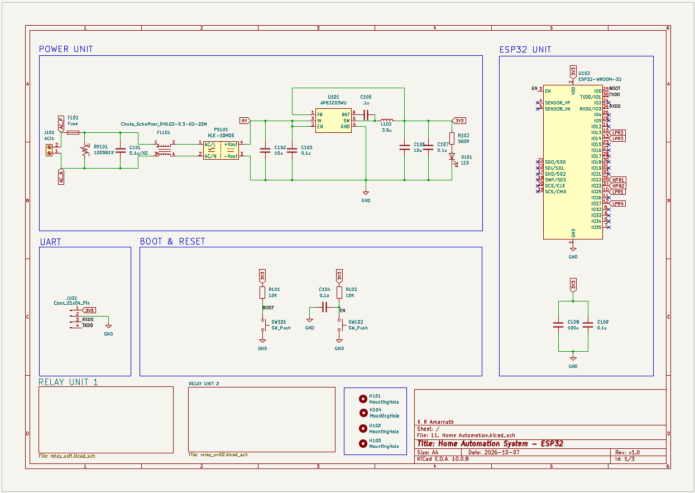
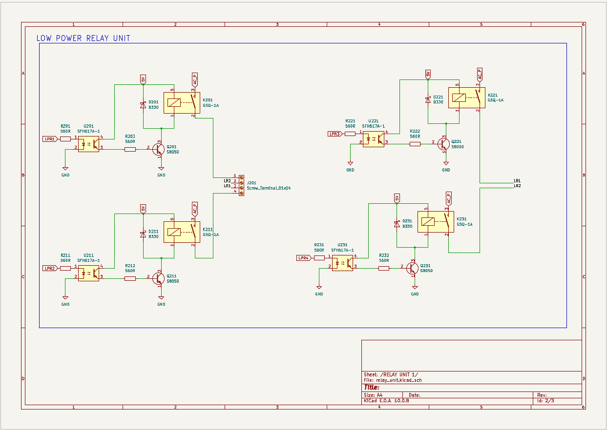
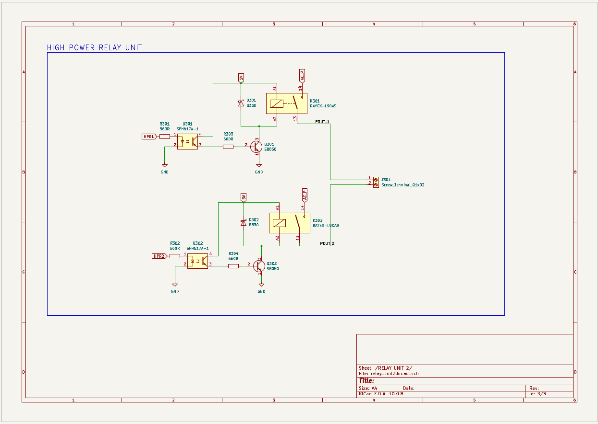
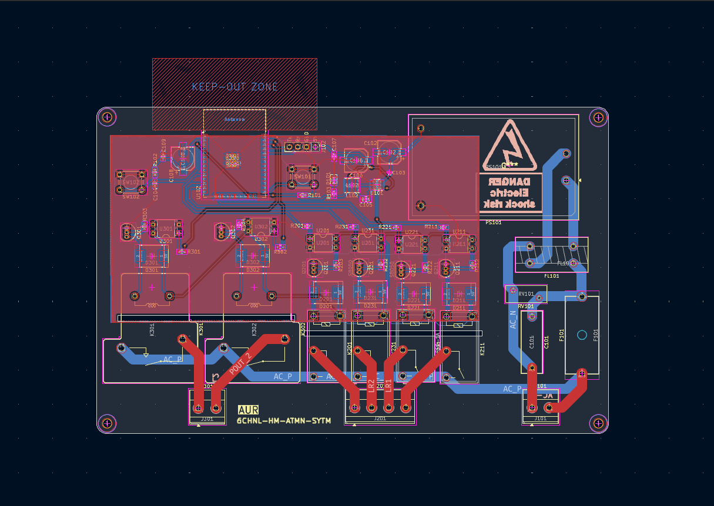
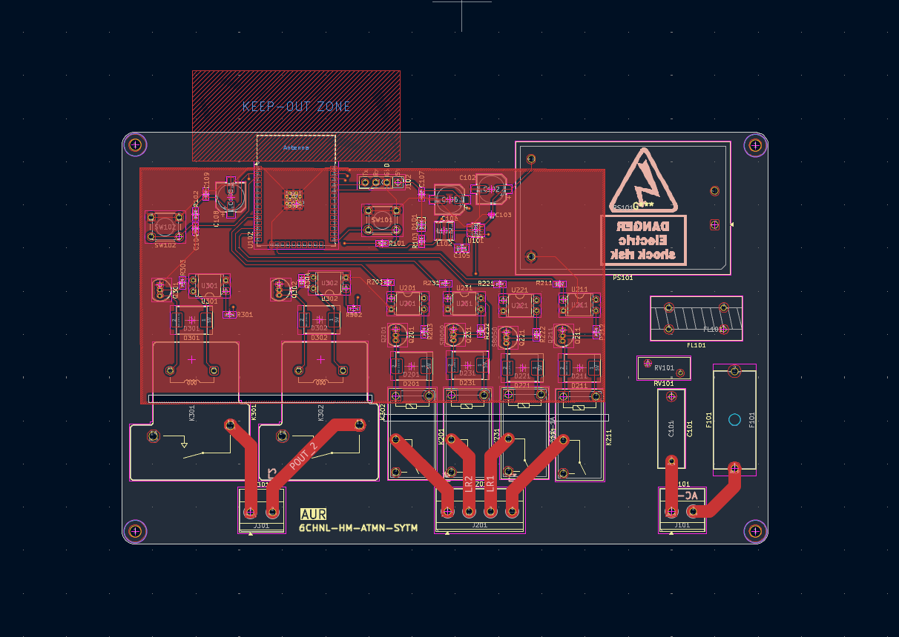
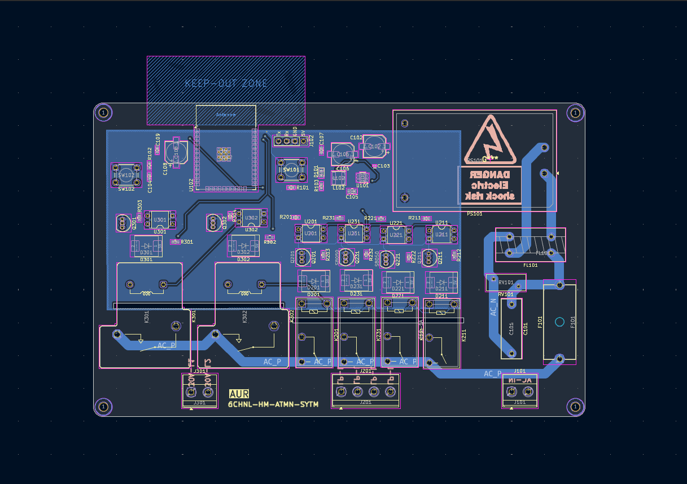
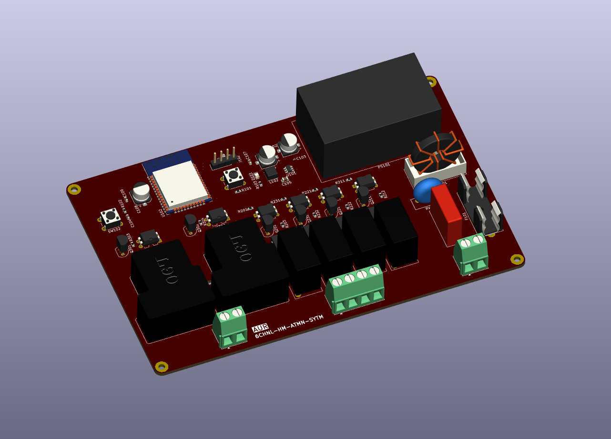
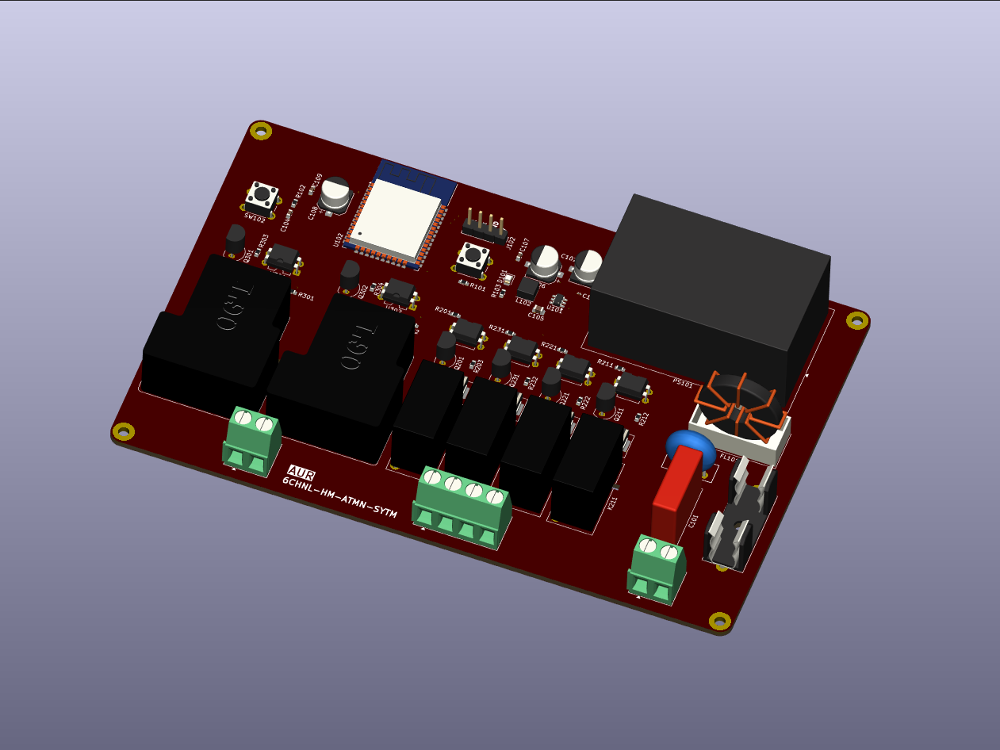

# ESP32 Home Automation Board

## Description

A 2-layer PCB that switches up to **6 mains loads** from an **ESP32-WROOM-32** over Wi-Fi or Bluetooth. The board carries its own AC-DC supply and 3.3 V regulator, so it runs directly from the mains. Designed in KiCad 10.

> ⚠️ **Mains voltage warning.** This board contains mains-voltage circuitry and has not been tested or safety-certified. Only work on it if you are qualified to handle mains electricity.

> **Status:** PCB layout completed (not fabricated).

## Repository Structure

```
.
├── README.md
└── docs/
    ├── images
    └── BoM
```

## Features

- ESP32-WROOM-32 with Wi-Fi (802.11 b/g/n) and Bluetooth/BLE
- 6 relay channels: 4 × 10 A (Omron G5Q-1A) and 2 × 30 A (Rayex L90AS)
- Optocoupler and transistor driver for every relay, with a flyback diode on every coil
- On-board 5 V supply (HLK-10M05) with fuse holder, varistor, X2 capacitor and common-mode choke
- 3.3 V buck converter (AP63203)
- UART header for flashing, plus BOOT and EN (reset) buttons
- Power indicator LED
- Screw terminals for mains input and relay outputs

## Specifications

| Item | Value |
|---|---|
| Microcontroller | ESP32-WROOM-32 |
| Relay channels | 6 (4 × 10 A, 2 × 30 A, all normally open) |
| 5 V supply | Hi-Link HLK-10M05, 10 W |
| 3.3 V supply | AP63203 buck converter, 2 A |
| Relay isolation | SFH617A-1 optocoupler (5300 VRMS) |
| Board size | 149.5 mm × 95.4 mm |
| Layers / thickness | 2 layers, 1.6 mm |
| Mains trace width | 3 mm |
| Mounting | 4 × M2.5 holes |
| Design tool | KiCad 10 |

## Working Principle

Each ESP32 GPIO drives an optocoupler LED through a 560 Ω resistor. The optocoupler switches an S8050 transistor, which energises the relay coil. A B330 diode across the coil absorbs the voltage spike when the relay turns off. The relay contacts then switch the mains live line to the load terminal.

## How to Use

1. Connect the load wires to the relay output terminals (J201 for relays 1–4, J301 for relays 5–6) and the mains supply to J101.
2. Flash the firmware (see below), then power the board from the mains.
3. Switch each relay by setting its GPIO HIGH (on) or LOW (off):

| Relay | GPIO |
|---|---|
| 1 | IO25 |
| 2 | IO13 |
| 3 | IO14 |
| 4 | IO27 |
| 5 | IO22 |
| 6 | IO23 |

### Flashing the Firmware

1. Disconnect the mains. Connect a 3.3 V USB-UART adapter to the J102 header: adapter GND to pin 2, adapter TX to pin 3 (RX) and adapter RX to pin 4 (TX). Use either the adapter's 3.3 V on pin 1 or the board's own supply, not both.
2. Hold **SW101 (BOOT)**, tap **SW102 (EN)**, then release BOOT. The ESP32 is now in download mode.
3. Flash with `esptool.py`, the Arduino IDE or PlatformIO.

### PCB Images

### Schematic

<div align="center">
  <table>
    <tr>
      <td align="center">
        <br>
        <b>Schematic 1</b>
      </td>
      <td align="center">
        <br>
        <b>Schematic 2</b>
      </td>
      <td align="center">
        <br>
        <b>Schematic 3</b>
    </tr>
  </table>
</div>

### Copper Layers

<div align="center">
  <table>
    <tr>
      <td align="center">
        <br>
        <b>Layout</b>
      </td>
      <td align="center">
        <br>
        <b>Front Copper Layer</b>
      </td>
      <td align="center">
        <br>
        <b>Back Copper Layer</b>
      </td>
    </tr>
  </table>
</div>


### 3D Model

<div align="center">
  <table>
    <tr>
      <td align="center">
        <br>
        <b>PCB 3D Image-1</b>
      </td>
      <td align="center">
        <br>
        <b>PCB 3D Image-2</b>
      </td>
    </tr>
  </table>
</div>

---

## Bill of Materials

A summary is below. The full list with designators is in [`hardware/BoM.csv`](hardware/BoM.csv).

| Qty | Part | Value / Type |
|---|---|---|
| 1 | Microcontroller module | ESP32-WROOM-32 |
| 1 | AC-DC module | HLK-10M05 (5 V, 10 W) |
| 1 | Buck converter + inductor | AP63203WU + 3.9 µH |
| 4 | Relay | Omron G5Q-1A (10 A) |
| 2 | Relay | Rayex L90AS (30 A) |
| 6 | Optocoupler | SFH617A-1 |
| 6 | Transistor | S8050 |
| 6 | Flyback diode | B330 |
| 4 | Mains protection and filter | Fuse holder, 10D561K varistor, 0.1 µF X2 capacitor, RN102 common-mode choke |
| 9 | Capacitors | 0.1 µF (×4), 10 µF (×3), 100 µF (×1) |
| 15 | Resistors | 560 Ω (×13), 10 kΩ (×2) |
| 1 | LED | Power indicator |
| 2 | Push button | BOOT and EN |
| 4 | Connectors | AC input, relay output (×2), UART header |
| 4 | Mounting holes | M2.5 |

## License

Add your license here (for example MIT for the files, CERN-OHL for the hardware).
